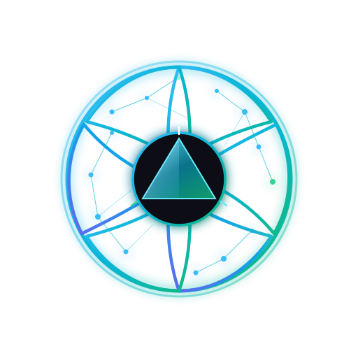
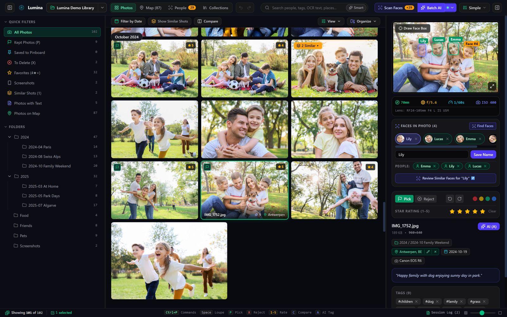
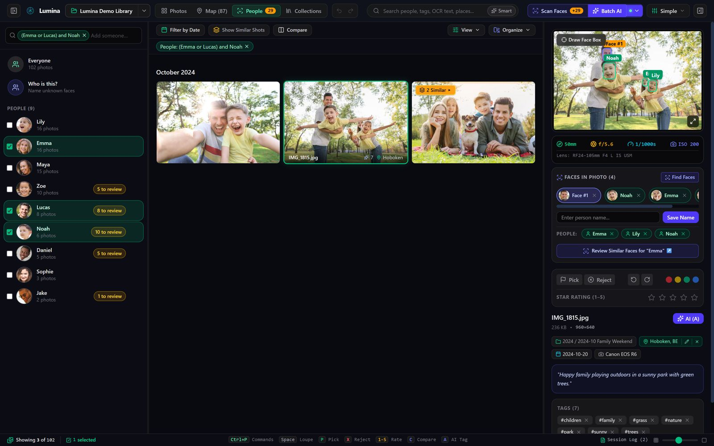
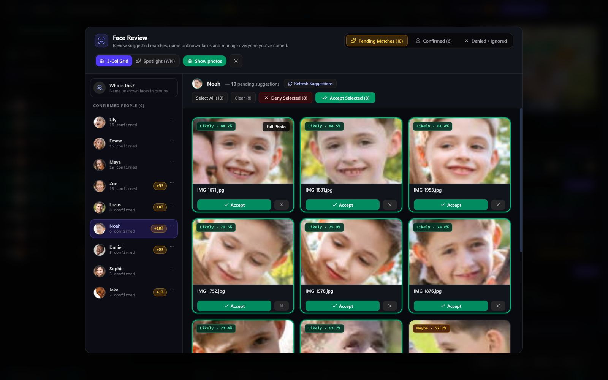
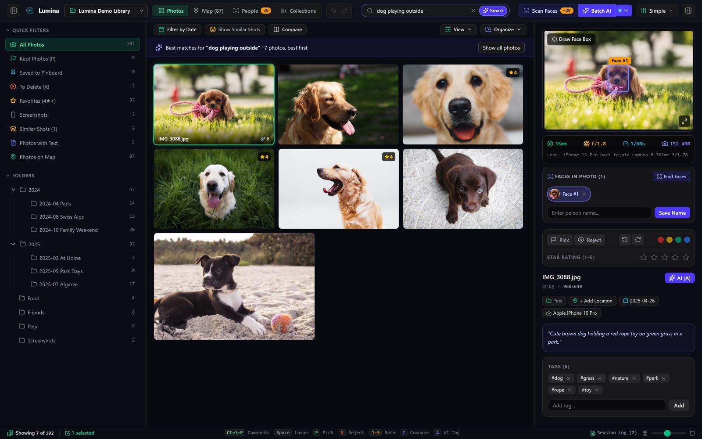
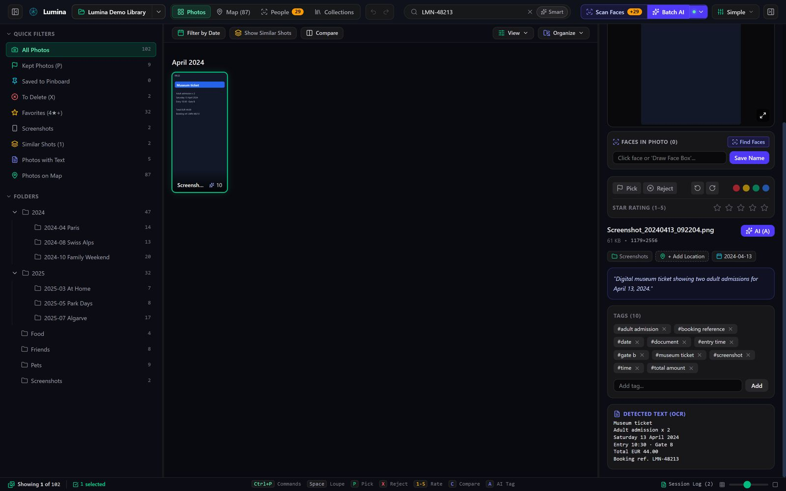
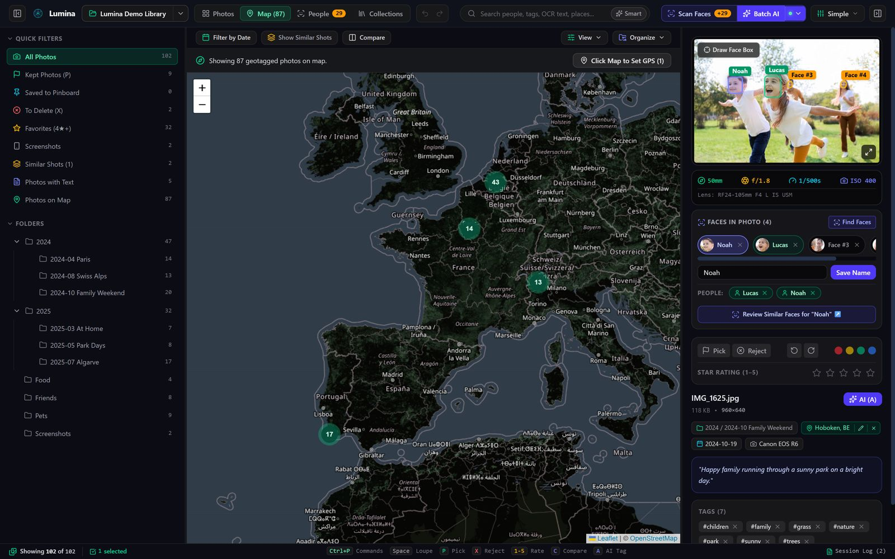
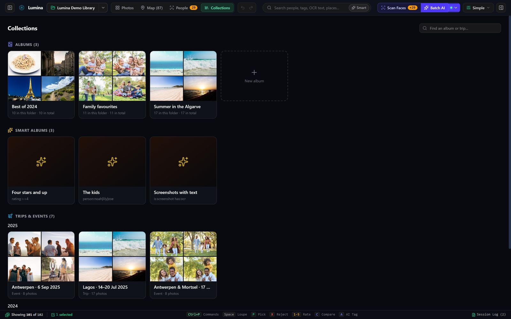
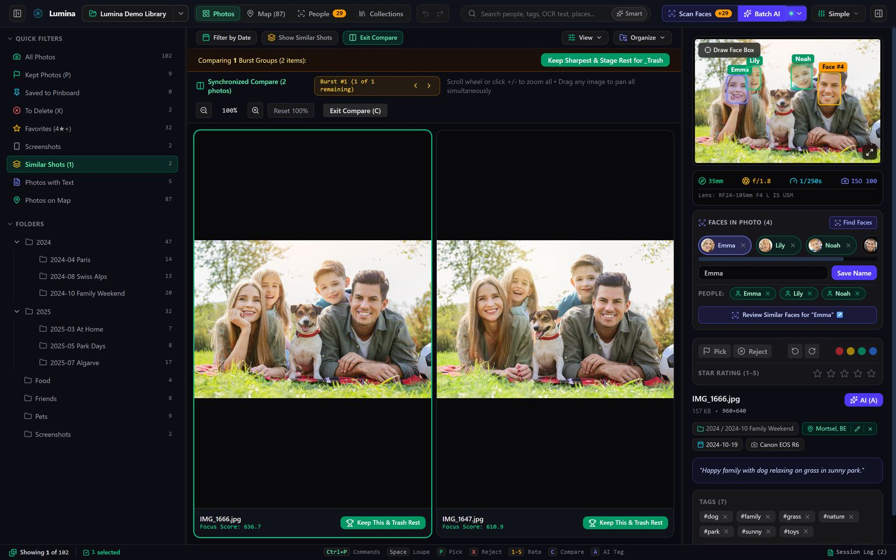
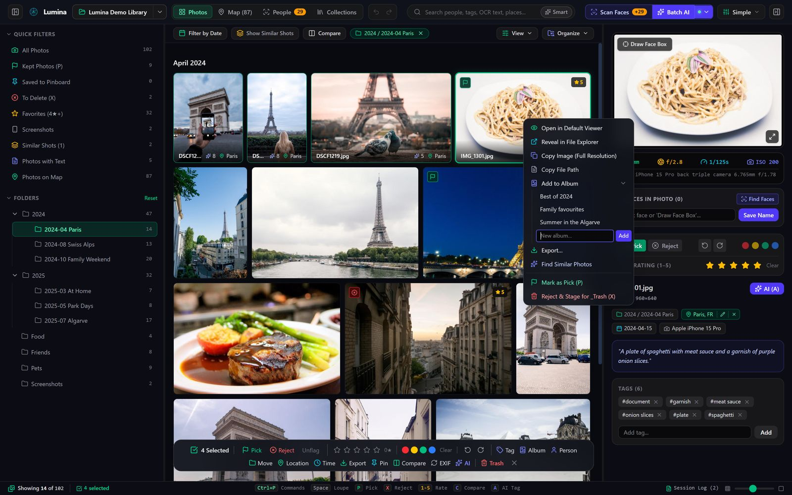

<div align="center">
  
  <h1>Lumina</h1>
  <p><strong>Sort, find and cull a lifetime of photos on your own PC and home server.</strong></p>
  <p>
    
    
    
    
    
  </p>
</div>



Lumina is a desktop app for working through a large photo library. It recognises the people in your
photos, writes a caption and tags for each one, lets you search by describing a photo, puts your trips on a
map and helps you keep the sharpest shot of every burst. It also runs as a server at home, so everyone in
the house reaches one library from their own computer or a web browser.

Face recognition, captions, smart search and place names all run on your own machines. Your photos are never
sent to anyone else.

## Features

### People



- **Face recognition** with InsightFace models (SCRFD detector, ArcFace embeddings), on the GPU through
  DirectML or on the CPU.
- **Name a face once** and Lumina suggests the same person in your other photos. Accept a whole row of
  suggestions at once, or go through them one by one with <kbd>Y</kbd> / <kbd>N</kbd>.
- **“Who is this?”** groups faces you haven't named yet, so you can name a whole group in one go.
- **Combine people** in the People tab: `anna and bob`, `anna or bob`, `(emma or lucas) and noah`,
  `anna and not bob`.
- Rename, merge or hide people, and choose each person's profile picture, from a right-click menu.



### Search



- **Smart search:** describe the photo (“dog playing outside”, “verjaardagstaart”) and Lumina ranks your
  library by how well each picture matches. It understands about 50 languages, using a multilingual CLIP
  model.
- **Find similar** photos from any photo's right-click menu.
- **Filters** in the search box, with suggestions as you type and chips you can remove:

  | Filter | Example |
  | :--- | :--- |
  | Rating, flag, label | `rating:>=4` · `flag:pick` · `label:red` |
  | People and tags | `person:anna` · `person:anna\|bob` · `tag:beach` |
  | Place, camera, lens, file name | `place:lagos` · `camera:"EOS R6"` · `lens:24-70` · `name:IMG_12` |
  | Dates | `date:2024` · `date:2024-06` · `date:2024-06-01..2024-06-30` · `date:<2020` |
  | Properties | `has:gps` · `has:faces` · `has:ocr` · `is:raw` · `is:video` · `is:screenshot` · `is:whatsapp` · `album:"Holiday"` |

  Put `-` in front of a filter to exclude it (`-flag:reject`). Save any search as a smart album that keeps
  itself up to date.
- **Text in photos (OCR)** is indexed: search for a booking reference, a street sign or a recipe ingredient.
- **Plain sentences**, in English or Dutch: “lily and emma in antwerpen”, “summer 2024”, “kerst vorig jaar”,
  “emma playing in the park”. Lumina picks out people, dates and places, shows what it understood as chips
  you can remove, and uses smart search for the rest.



### Places, trips and collections

| | |
| :---: | :---: |
|  |  |

- **Map** of every geotagged photo, with clusters. Click the map to set a location on photos without GPS.
- **Place names** come from an offline database: no lookups are sent anywhere.
- **Trips and events** are found automatically from dates and locations (“Lagos · 14–20 Jul 2025”) and can
  be renamed.
- **Albums** that span library folders, and **smart albums** built from a saved search.
- **Highlights** of any trip, album, folder or selection: the best 10, 20 or 50 photos, chosen on your
  ratings and picks, open eyes, sharp faces, how good a photo looks, and variety (never two from the same
  burst). **Best of** each year is one click in Collections.
- **On this day:** a strip above the grid with the best photos taken on today's date in earlier years.

### Videos

- **Videos are part of the library:** in the grid with their length, on the map, in trips and albums, and
  dated by when they were recorded. Lumina reads the date, place, size and camera from the video file.
- **Played inside Lumina** (H.264, HEVC, AV1, VP9). Older formats such as MTS, AVI and MPEG get a playable
  copy on request; Lumina downloads ffmpeg once for this.
- **All / Photos / Videos** on the Photos, People and Map tabs.
- **Live Photos:** an iPhone Live Photo's clip hides behind its photo, even in another folder, and plays when
  you hover LIVE in full screen or hold <kbd>L</kbd>.
- **Smart search and faces in videos:** Lumina looks at a few moments of each video, so a search finds what
  appears halfway through, and the people in a video show up under their name.

### Culling



- **Bursts and near-duplicates** are stacked together. Compare them side by side with synchronised zoom
  and a focus score under each one, then keep the best: open eyes first, then the sharpest faces.
- **Closed eyes and soft focus** are flagged on the photo, with quick filters and `is:blinking` /
  `is:blurry`. The sensitivity can be set (or switched off) in Settings.
- **Pick / reject / rate / colour label** from the keyboard, with optional auto-advance to the next photo.
- **Full-screen view** with a filmstrip, and a **timeline** to filter by year, month, week or day.
- **Find duplicates:** exact copies spread over your folders, and the same photo saved again as another file
  (a resized or edited copy). Lumina keeps the largest, oldest copy with the most info, moves ratings,
  people and albums onto it, and stages the others for `_Trash`.
- **Screenshots and WhatsApp photos** are recognised and have their own filters, and Best of leaves them
  out or ranks them lower.
- Rejected photos go to a `_Trash` folder first. Moves and renames are staged and only applied when you
  commit them. Almost everything can be undone with <kbd>Ctrl</kbd>+<kbd>Z</kbd>.
- **Emptying `_Trash`** moves photos and their sidecars to the Windows Recycle Bin. Lumina never lets Windows
  delete them for good: when the Recycle Bin can't hold them it asks first.

### Organise and share



- **Import** from a memory card, USB drive or folder into dated folders, skipping photos you already have.
  Lumina offers it when a camera card is connected, copies safely (verified before it counts) and keeps
  RAW+JPEG pairs and sidecars together. Photos added or removed outside Lumina show up by themselves.
- **Right-click** a selection to add it to an album, or create a new album on the spot.
- **Auto-stage** photos into folders by year, month, city or person.
- **Export** for sharing at full size, 2048 px or 1080 px, with the GPS location removed if you want. Your
  originals are never changed.
- **Share as a web page:** a folder with one self-contained page (grid, full-screen view, swiping on phones)
  to open locally or upload to any web host. Photos are saved at 2048 px without metadata; captions,
  names and a map are only included when you ask for them.
- **XMP sidecars** for ratings, flags and labels, without overwriting sidecars written by other apps, and a
  **CSV** of ratings, flags, tags, people and captions for spreadsheets.
- **Command palette** (<kbd>Ctrl</kbd>+<kbd>P</kbd>) to find any action by name.

### Your library

- **Settings** in one place (<kbd>Ctrl</kbd>+<kbd>,</kbd>).
- **Backups** of everything you added (ratings, people, captions, albums, settings) to one
  `.luminabackup` file, by hand or automatically every day or week. **Restore** it on the same PC or a new
  one: point each library folder to where the photos are now and everything follows them.
- **Photo dates** come from the camera (EXIF), else from the file name (`IMG_20230615_…`, WhatsApp), from
  Google Takeout's JSON files for a Google Photos export, or from a year in the folder name, before falling
  back to the file's own date.
- **Large libraries** on a hard drive are indexed in the background and saved as they go, so an interrupted
  first index resumes where it stopped.
- **Updates** are checked once a day and installed with one click from GitHub Releases.

### A home server

- **Lumina server** keeps the library on a Linux PC at home (Docker, with the NVIDIA GPU): it indexes new
  photos, finds faces, builds smart search and writes captions by itself. Reach it over Tailscale.
- **Accounts** for everyone in the house, each with a role per library (look, upload, edit, admin), and a
  **web client** in any browser with the same grid, people, map and search.
- **Share an album or a smart album** with someone: they see only that, also from the web.
- **In the app:** Settings → Servers connects to a server. Its libraries open next to the folders on your PC;
  drop files on the window to upload, download originals, and see which photos are on this PC already.
- **All photos** shows the folders on this PC and your servers' libraries in one grid, each photo once, with a
  mark for what isn't backed up, what is only on the server and what is shared with you. Edits go to where
  the photo lives; the copy on this PC follows.
- **Back up now** sends what is only on this PC to the server, with its ratings, tags, albums and people names.
- **Follow** an album shared with you: its photos come into a folder of yours, with the people in them and their
  tags, and new ones follow by themselves.
- **People across libraries:** the same name is one person, a person from another library can get a name of
  your own, and Lumina suggests when two people look like one.

### Formats

JPEG, PNG, HEIC/HEIF and RAW (CR2, CR3, NEF, ARW, DNG, ORF, RW2, PEF, RAF). RAW files show their embedded
preview; a RAW file and its JPEG are treated as a pair.

Videos: MP4, MOV, M4V, 3GP, AVI, MTS, M2TS and MPG.

## Requirements

- **Windows 10 or 11.** HEIC support uses the Windows imaging codecs (install *HEIF Image Extensions* from
  the Microsoft Store if HEIC files don't show). iPhone videos (HEVC) need *HEVC Video Extensions* from the
  Microsoft Store to show and play.
- **[Ollama](https://ollama.com)** for captions, tags and OCR, with a vision model. Lumina can start Ollama
  and download the default model (`qwen3-vl:8b-instruct`) for you. It also offers to switch on Ollama's flash
  attention, which is about 10–15% faster.
- **A GPU is recommended**, not required. On an RTX 5070 Ti, Lumina captions about 50 photos a minute and
  answers a smart search in about 3 ms.
- The face models and the smart-search models (about 500 MB) download automatically the first time you use
  those features. Downloads are checked against pinned SHA-256 hashes.

- **A Lumina server** (optional) runs on Linux in Docker with an NVIDIA GPU: see
  [server/README.md](server/README.md).

### Linux and Mac

- **Linux:** each release has an AppImage (updates itself) and a .deb for Debian and Ubuntu. Lumina uses the
  system's ffmpeg for video frames and HEIC, and GStreamer's "good" plugins to play videos (the .deb installs
  both; with the AppImage, install `ffmpeg` and `gst-plugins-good` yourself). Built on Ubuntu 24.04, so it
  needs a system at least that recent.
- **Mac (Apple Silicon):** the .dmg works with the photo libraries on a Lumina server for now; opening folders
  on the Mac itself comes later. The app isn't signed by Apple yet: the first time, right-click Lumina in
  Applications and choose **Open**, then **Open** again. Intel Macs aren't supported.

## Development

Prerequisites: Node.js 18+, the Rust toolchain ([rustup.rs](https://rustup.rs)) and the
[Tauri v2 prerequisites](https://v2.tauri.app/start/prerequisites/) for Windows.

```bash
git clone https://github.com/MaartenVerleyen/Lumina.git
cd Lumina
npm install
npm run tauri dev
```

Checks:

```bash
npx tsc --noEmit          # type-check the frontend
npm test                  # frontend unit tests (search syntax, people queries, layout, trips, ...)
cd src-tauri
cargo test --lib          # backend unit tests
```

A release build is made with `npm run tauri build`; [docs/RELEASING.md](docs/RELEASING.md) covers versions,
update signing, code signing and publishing a release. See [docs/ARCHITECTURE.md](docs/ARCHITECTURE.md) for
how the app is put together and [CONTRIBUTING.md](CONTRIBUTING.md) for guidelines.

## Keyboard shortcuts

| Shortcut | Action |
| :--- | :--- |
| <kbd>Space</kbd> | Full-screen view (Loupe) |
| <kbd>P</kbd> / <kbd>X</kbd> / <kbd>U</kbd> | Pick / reject to `_Trash` / unflag |
| <kbd>1</kbd>–<kbd>5</kbd> / <kbd>0</kbd> | Star rating / clear rating |
| <kbd>6</kbd>–<kbd>9</kbd> | Red / yellow / green / blue label |
| <kbd>[</kbd> / <kbd>]</kbd> | Rotate left / right |
| <kbd>C</kbd> / <kbd>G</kbd> / <kbd>M</kbd> | Compare / grid / map |
| <kbd>A</kbd> | Caption and tag the photo with AI |
| <kbd>B</kbd> | Add to or remove from the pinboard |
| <kbd>Ctrl</kbd>+<kbd>1</kbd>–<kbd>4</kbd> | Photos / Map / People / Collections |
| <kbd>Ctrl</kbd>+<kbd>K</kbd> | Search |
| <kbd>Ctrl</kbd>+<kbd>P</kbd> | Command palette |
| <kbd>Ctrl</kbd>+<kbd>Z</kbd> / <kbd>Ctrl</kbd>+<kbd>Y</kbd> | Undo / redo |
| <kbd>Ctrl</kbd>+<kbd>L</kbd> | Session log |
| <kbd>?</kbd> | All shortcuts |

## Licences and credits

- The face models are InsightFace's `buffalo_l` models, which are licensed for **non-commercial research
  use only**. Check their licence before distributing Lumina commercially.
- Smart search uses CLIP ViT-B/32 (MIT) and `clip-ViT-B-32-multilingual-v1` (Apache-2.0).
- The screenshots show a demo library of public-domain (CC0) stock photos from
  [StockSnap](https://stocksnap.io), found through [Openverse](https://openverse.org). The names, dates and
  locations in it are made up.
